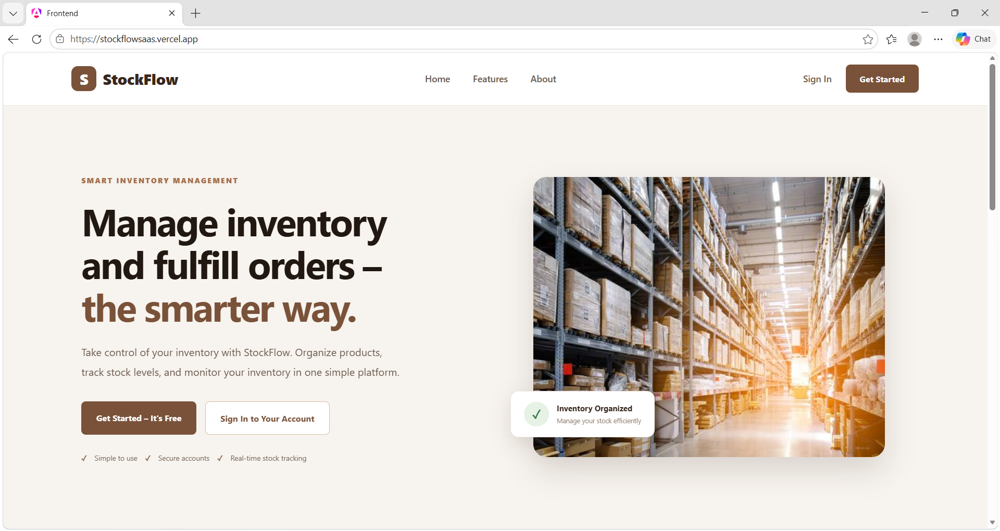
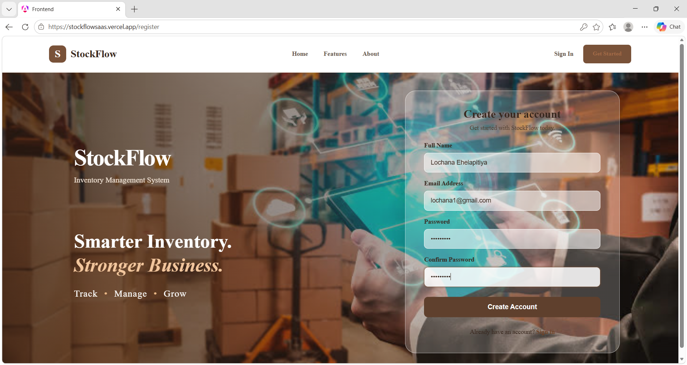
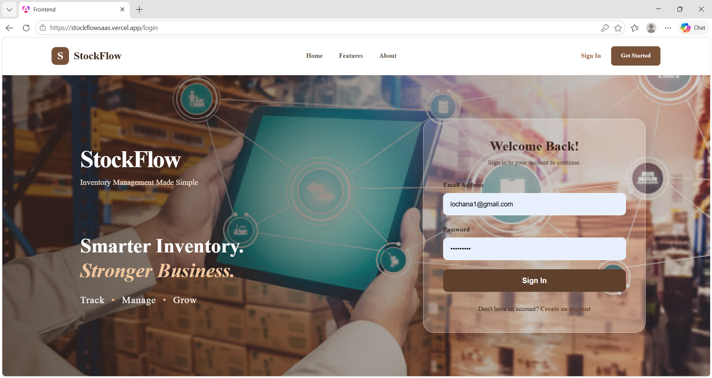
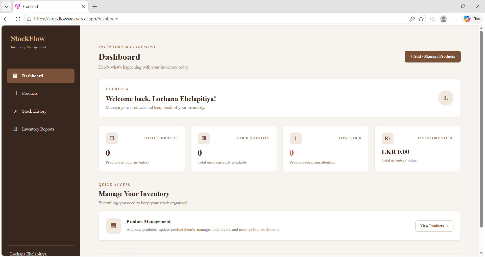
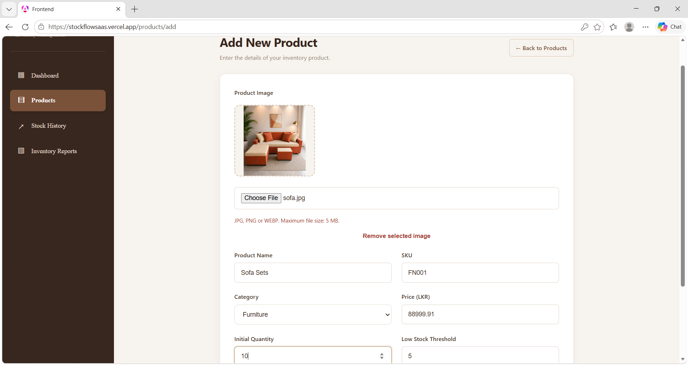
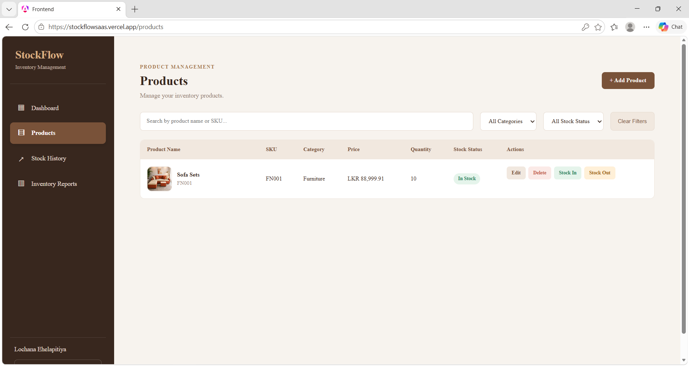
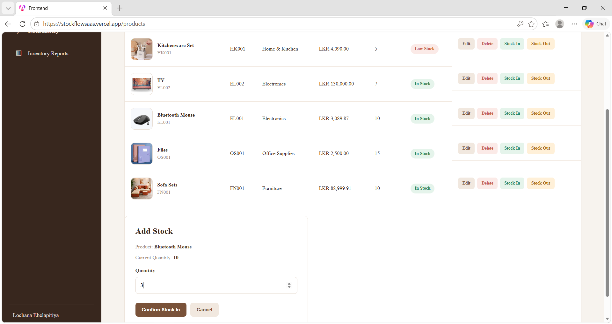
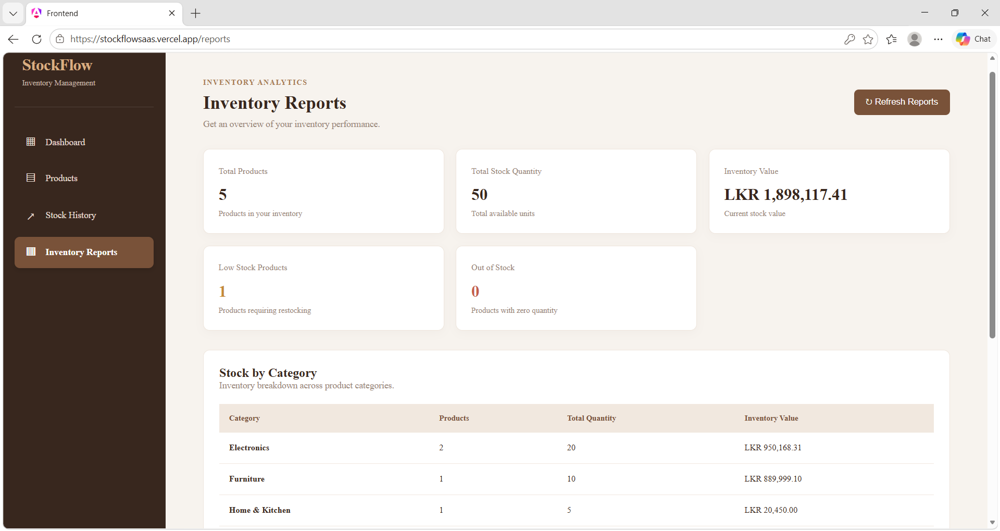
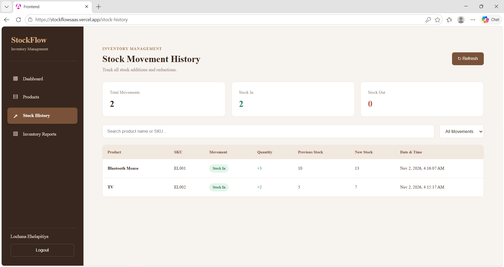

# StockFlow – Inventory Management SaaS

A multi-user Inventory Management SaaS application that helps businesses manage products, monitor stock levels, record stock movements, and generate inventory reports through a responsive web dashboard.

**Developed as a technical assignment for Webcomms Global (Pvt) Ltd.**

## Live Application

- **Frontend:** https://stockflowsaas.vercel.app/login
- **Backend API:** https://stockflow-api-cjd6g2d3bab4bebm.southeastasia-01.azurewebsites.net
- **GitHub Repository:** https://github.com/lochana2002/inventory-management-saas

## Project Overview

StockFlow is designed as a multi-user inventory management platform. Each registered user can securely manage their own inventory, with authentication and user-specific data access.

The application provides tools to manage products, track stock movements, identify low-stock items, and monitor inventory performance.

## Features

### Authentication and Security
- User registration and login.
- JWT-based authentication.
- Secure password hashing.
- Protected API endpoints.
- User-specific data separation.

### Dashboard
- Total products overview.
- Available stock summary.
- Low-stock product overview.
- Inventory statistics.

### Product Management
- Create, view, update, and delete products.
- Manage product names, SKUs, categories, prices, and quantities.
- Upload product images.
- Search products by name or SKU.
- Filter products by category and stock status.

### Stock Management
- Add stock (Stock In).
- Reduce stock (Stock Out).
- Prevent negative stock quantities.
- Record stock movements.

### Reports and History
- View stock movement history.
- Monitor inventory changes.
- Generate inventory reports.

## Technologies Used

### Frontend
- Angular 21
- TypeScript
- HTML5
- CSS3

### Backend
- ASP.NET Core Web API (.NET 9)
- C#
- Entity Framework Core
- JWT Authentication
- ASP.NET Core Identity

### Database
- Microsoft SQL Server
- Azure SQL Database (production)
- SQL Server Express (local development)

### Deployment
- Vercel – Frontend hosting
- Microsoft Azure App Service – Backend hosting
- Azure SQL Database – Production database

## Project Structure

```text
inventory-management-saas/
│
├── frontend/
│   └── src/
│       └── app/
│           ├── features/
│           ├── services/
│           └── ...
│
├── backend/
│   └── InventoryManagement.API/
│       ├── Controllers/
│       ├── Data/
│       ├── DTOs/
│       ├── Models/
│       ├── Services/
│       ├── Migrations/
│       ├── Program.cs
│       └── appsettings.json
│
├── .gitignore
└── README.md
```

## Installation and Setup

### Prerequisites

Install the following tools:

- [Node.js](https://nodejs.org/)
- [Angular CLI](https://angular.dev/tools/cli)
- [.NET 9 SDK](https://dotnet.microsoft.com/download/dotnet/9.0)
- [SQL Server Express](https://www.microsoft.com/en-us/sql-server/sql-server-downloads)
- [SQL Server Management Studio (SSMS)](https://learn.microsoft.com/en-us/ssms/install/install)

### 1. Clone the Repository

```bash
git clone https://github.com/lochana2002/inventory-management-saas.git
cd inventory-management-saas
```

### 2. Configure the Database

The application uses Microsoft SQL Server.

For local development, create or configure the `InventoryManagementDB` database using SQL Server Express.

Configure the connection string in the backend configuration or through the `ConnectionStrings__DefaultConnection` environment variable.

Example local connection string:

```text
Server=.\\SQLEXPRESS;Database=InventoryManagementDB;Trusted_Connection=True;TrustServerCertificate=True;
```

**Important:** Do not commit database passwords, production connection strings, or other secrets to GitHub.

### 3. Run Database Migrations

Open a terminal in the backend project directory:

```bash
cd backend/InventoryManagement.API
```

Restore the dependencies:

```bash
dotnet restore
```

Apply the Entity Framework Core migrations:

```bash
dotnet ef database update
```

If the EF Core command is unavailable, install the .NET EF tool:

```bash
dotnet tool install --global dotnet-ef --version 9.0.6
```

### 4. Run the Backend

From the backend project directory:

```bash
dotnet run
```

The local API runs at:

```text
http://localhost:5174
```

Swagger documentation is available in the Development environment:

```text
http://localhost:5174/swagger
```

### 5. Run the Frontend

Open another terminal:

```bash
cd frontend
```

Install dependencies:

```bash
npm install
```

Start the Angular development server:

```bash
ng serve
```

Open the application:

```text
http://localhost:4200
```

## Configuration and Environment Variables

The backend requires the following configuration values:

| Variable | Purpose |
|---|---|
| `ConnectionStrings__DefaultConnection` | Database connection string |
| `Jwt__Key` | JWT signing key |
| `Jwt__Issuer` | JWT issuer |
| `Jwt__Audience` | JWT audience |

Use your own local development values. Production values are configured securely in Azure App Service and should not be added to source control.

## Screenshots and Demonstration

### Home Page


### Register Page


### Login Page


### Dashboard


### Product Management


### Product Management


### Stock Management


### Inventory Reports


### History


### Dashboard


## Project Status

**Completed – Deployed and available online.**

